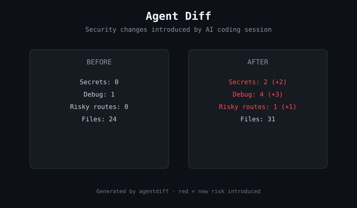

# agentdiff

> See what your AI coding agent changed — from a security perspective.  
> One command. Pure SVG. Local.

<div align="center">



**Most tools tell you what is wrong now. agentdiff shows what the agent just introduced.**

```bash
npx agentdiff ./before ./after
```

[](LICENSE)
[](https://nodejs.org/)
[](https://github.com/ilyasaalmadani/agentdiff/stargazers)

</div>

---

## Why agentdiff?

AI coding agents can introduce secrets, debug leftovers, or unprotected routes in a single session.  
**agentdiff** compares two folders (before and after) and generates a clear SVG of the security delta.

Red numbers mean new risk was introduced. Green means no change or improvement.

Nothing leaves your machine. The output is a self-contained SVG you can drop into a PR, README, or Slack.

## Quick start

```bash
npx agentdiff ./before ./after
# writes agentdiff.svg

npx agentdiff ./snapshot-1 ./snapshot-2 my-diff.svg
```

Embed it:

```markdown

```

## What it measures

| Signal | What increases the risk count |
|--------|-------------------------------|
| Secrets | Hardcoded keys, tokens, API keys |
| Debug | `console.log` of secrets, `debugger;` |
| Risky routes | Admin/internal paths without obvious protection |

Heuristics are intentionally lightweight and local.

## Relationship to other tools

| Tool | Role |
|------|------|
| **agentdiff** | Visual security delta of an AI coding session (this repo) |
| **riskmap** | Static map of where risk lives in a project |
| **secradar** | Multi-axis radar of overall posture |
| **SHIPSAFE** | Full local Mac scanner (148 checks) |

agentdiff is the open-source visual layer for "what changed". It does not replace the deep scanner.

## Roadmap

- [x] Before/after folder comparison
- [x] Pure SVG output
- [ ] Git commit range support
- [ ] JSON output
- [ ] More precise rules
- [ ] GitHub Action

## License

MIT © [Ilyas Akbar Almadani](https://github.com/ilyasaalmadani)

---

<div align="center">

**Built for developers who want to see what the agent actually changed.**

Star the repo if the diff is useful.

</div>
